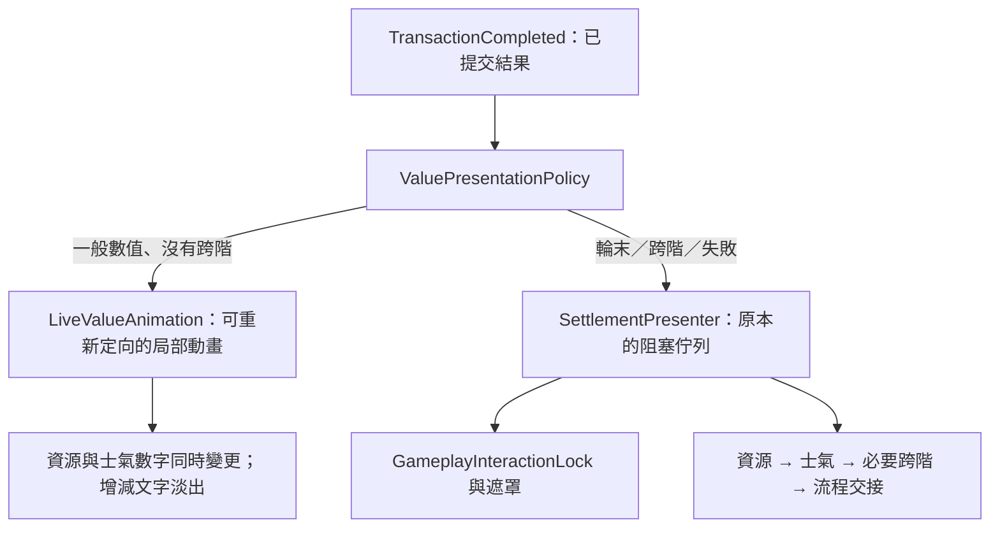

# E2 呈現分流：一般數值不中斷操作

日期：2026-10-30。以本文件的使用者確認規則取代先前「所有交易都鎖定播放」的呈現方式。

## 規則

| 結果 | 呈現 | 操作鎖 |
| --- | --- | --- |
| 一般卡牌、事件、System 數值變更，士氣未跨階 | 數值與局部增減動畫並行 | 不新增鎖定 |
| 士氣跨階，不論回合內或回合外 | 立即進入既有分段／中央演出 | 鎖定 |
| 固定輪末，即使本次沒有數值變化 | 既有結算順序與單次交接 | 鎖定 |
| 輪末同時跨階 | 同一筆結算工作包含跨階演出 | 鎖定，不重複建立工作 |
| 士氣歸零 | 保留立即 Failed、呈現與崩潰報告接管 | 維持失敗限制 |
| Reset | 直接同步狀態 | 不建立新的演出鎖 |

跨階不延後到輪末；判斷讀取完整交易的正式 StageChanged 結果，也包含士氣上限下降、夾限造成的跨階。歸零即使沒有新跨階，也保留失敗接管。

## 腳本關係

- `SettlementPresenter.OnCompleted` 依政策分流，僅阻塞路徑取得鎖。
- `IsBlockingPresentation` 表示阻塞佇列持有 HUD，`IsLiveAnimating` 表示局部數字仍在變動；`IsPresenting` 表示任一呈現仍在進行，不能拿它直接判斷是否禁止互動。
- `LiveValueAnimation` 僅保存顯示起點、目標、時間與短時間內合併的實際淨變化，不修改任何遊戲數值。
- 一般動畫約 0.32 秒，減少動態為 0.08 秒。動畫期間可繼續出牌、選擇事件或結束回合；付款與可用資源始終讀取權威系統。
- 新交易從目前顯示數字轉向最新目標，短時間連續變更的增減標記合併為淨值。單一更新路徑避免較早動畫回呼覆寫較新結果。
- 永久與臨時食物各自計數，食物增減標記顯示兩者合計淨變化。
- 跨階或輪末接管前，清除局部動畫並同步該交易的正式 Before 快照；不等待局部動畫播放完。
- 阻塞呈現期間收到的一般變更暫存於局部動畫狀態，不搶寫阻塞 HUD；結束後才恢復局部更新。
- 一般動畫不打開遮罩、不關閉士氣明細，也不等待左鍵／Space 釋放；其他介面原有的合法鎖不會被它解除。
- 重設與停用會清除局部動畫，避免舊數字回寫。

## 驗證

49 項定向 EditMode 測試通過：新分流測試 23 項、既有交易測試 17 項、E1 預警測試 9 項。Unity 編譯與 Console 檢查通過。本輪沒有自動進入 Play，沒有修改三份場景的內容。

新測試包括：普通 Card／Event／System 不阻塞、士氣不跨階與跨階、上限夾限造成跨階、無變更輪末、輪末同時跨階、無新跨階的歸零、Reset、連續增減重新定向、零淨變化、永久／臨時食物合計、減少動態、實際 Presenter 不取得鎖或顯示遮罩、重複完成、重設取消、尊重其他鎖，以及阻塞 HUD 不被局部更新蓋過。

原始結果：`Assets/production/qa/evidence/pb-p0-014e-responsive-values-tests.json`。
人工確認方式：在 SampleScene 完成開局事件後連續打出普通牌；數字可持續演出但可立即操作下一張。另測真正士氣跨階與固定輪末，確認仍顯示遮罩／中央演出並維持單次交接。實體輸入手感與 Play 端到端尚待實際操作確認。

## 增減提示可讀性調整

增減字預設由原建立工具的 19 提升為 34，加粗、深色描邊，使用較亮的紅／綠色，放在主數字上方。提示區域為 180×54，可在 ResourceValuePresenter 的 Delta readability 欄位調整。動畫時間與鎖定規則維持原樣；本次只做字體與位置調整，未重新執行 Play 驗收。
