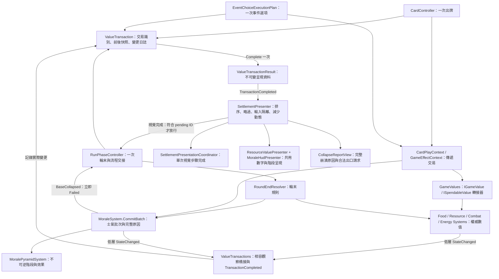

# E2：明確交易上下文與共用數值呈現

實作日期：2026-10-29。程式已實作；人工輸入、指定解析度與灰階驗收仍須依 QA 紀錄完成。

## 腳本關聯圖



實線為呼叫／資料或事件方向。Presenter 不呼叫付款、士氣提交或階段效果變更。動畫完成與交易完成是不同事件。

## 修改接口如何選擇

- `IGameValue`：`Current`、`Set(value, transaction)`、`Change(delta, transaction)`、`StateChanged`、`TransactionCompleted`。
- `ISpendableValue`：加上 `CanSpend(amount)`、`TrySpend(amount, transaction)`。`Change(-amount)`也走完整付款檢查；不足時回傳 false，沒有部分付款。
- `GameValues.All` 可用 `IReadOnlyList<IGameValue>` 統一查詢與處理食物、資源、戰鬥值、能量。轉接器不另存一份權威數值。
- 強制損失、保留量、臨時食物與士氣批次保留原專用接口；交易不抹平這些規則。
- `Set` 仍受原系統合法性限制；增加後的實際值可能受上限限制，應讀取結果，不將 bool 當作「必定等於要求值」。

```csharp
using (var transaction = new ValueTransaction("Card:Example", ValueTransactionKind.Card))
{
    if (GameValues.Food.TrySpend(2, transaction))
        GameValues.Food.Change(2, transaction);
    var result = transaction.Complete();
    // Journal 有扣除和取得兩項；result.Delta(ValueId.Food) == 0。
}
```

## 邊界與相容策略

1. CardController、EventChoiceExecutionPlan 與 RunPhaseController 擁有交易邊界。同步巢狀效果加入現有交易，不用來源名稱、同幀或計時猜測邊界。
2. 標準卡牌／事件效果透過 Context 明確傳遞同一個 transaction。`Execute` 僅在同步呼叫期間建立舊 static API 的觀察範圍，讓尚未改簽名的輪末、強制損失等接口也能歸入相同交易。
3. `ValueTransactions` 的 static `observed` 只供相容橋接追蹤前一次通知；每筆交易的 Before/After 都是獨立值型快照，結果日誌、士氣原因與轉換清單也在完成時複製。不是所有動畫共用一份可覆寫結果。
4. 舊系統每次通知所暴露的實際數值差異會記入日誌；原有 API 若內部合併多次修改才通知，橋接不能憑空重建被合併的內部步驟。成就／統計本體未實作。
5. `Complete` 重複呼叫只回傳相同結果。中斷且已修改數值時，Dispose 發布 `Interrupted` 結果；不回滾、不補發獎勵。完全未修改的中斷不產生假動畫。
6. 交易上下文供主執行緒同步操作；不能跨 yield、執行緒或非同步工作持有執行範圍。新局會取消舊佇列、建立結果隔離界線；輪末交接以 pending transaction ID 排除舊完成回呼。
7. 低層 StateChanged 保留；E2 數字呈現由 TransactionCompleted 驅動。E1 預警／明細仍可重算，並不觸發數字增減動畫。初次綁定、重設與重新開啟直接同步快照。

## 呈現與流程

- 2026-10-30 分流修訂：一般數值變更使用不鎖操作的局部動畫；固定輪末、士氣跨階與失敗接管保留阻塞佇列，其順序為資源、士氣、必要跨階。食物 UI 同時呈現永久／臨時庫存，增減標記採兩者的實際合計淨變化。
- 當次跨兩階只展示真正舊效果與最終新效果，兩層留下輪廓和損毀標記；士氣回升不修復權威 Stage。
- 左鍵／Space 略過目前步驟，交接前等待輸入釋放並留一幀隔離；減少動態縮短計數、取消縮放。
- BaseCollapsed 立即令 Run 進入 Failed。報告等完整交易完成後才顯示，保留每項要求變化、實際變化與前後上限。
- 報告的「主要負向來源」明確按要求損失排序，不將要求扣除量誤稱為受限制後的實際因果分攤。
- Presenter 停用會取消動畫、同步權威快照並走單次即時交接；動畫例外亦有收尾路徑。崩潰後仍由 Run 的 Failed 守衛維持禁止推進。
- E3 尚未提供 Profile 選擇與完整重新開始流程。Report 的 RestartRequested / LeaveRequested 只發出一次請求，沒有訂閱合法入口就隱藏按鈕。

## 場景與操作

`GameplayHUD_P0_Integration` 保留 E2 驗證用途。2026-10-30 已另存 `Sample_E1E2_IntegrationTest`，並將驗證後的 E1／E2 接線整合到 `SampleScene`；沿用主場景真實手牌、事件、建築與探索控制器。細節見 `sample-e1-e2-integration.md`。無 Presenter 的相容路徑仍保留。

Edit 模式可執行 `Tools/QA/E2/Install presentation in current scene`，只補現有 E1 HUD 的 E2 元件；重複執行不重建。工具不自行儲存場景。Play 模式可用同目錄的跨兩階、完整崩潰、減少動態 QA 指令。

測試與待驗證項目見 `Assets/production/qa/evidence/pb-p0-014e-e2-evidence.md`。


目前呈現分流與測試：`e2-responsive-value-presentation.md`。跨階立即演出，不延後至輪末；一般卡牌／事件數值不再取得操作鎖。
