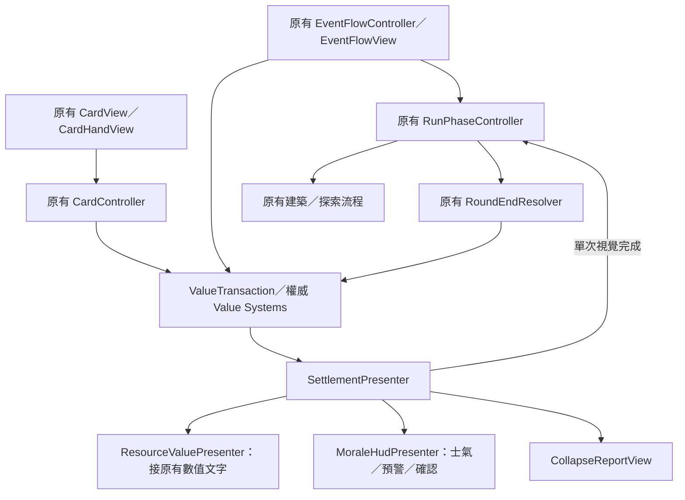

# SampleScene 的 E1／E2 整合

日期：2026-10-30。

## 已交付場景

- `Assets/Scenes/Sample_E1E2_IntegrationTest.unity`：從 SampleScene 另存的接線測試副本。
- `Assets/Scenes/SampleScene.unity`：測試副本通過接線驗證後，已套用同一份 E1／E2 接線；保留原 Scene GUID。
- `GameplayHUD_P0_Integration` 保留原有用途；Sample 的整合不依賴其示範初始化。

兩份 Sample 場景在交付時的 `.unity` 內容雜湊一致，`.meta` 的場景 GUID 各自獨立。

## 接線方式

保留主場景既有手牌 Prefab、出牌區、出牌效果、結束回合按鈕、事件／建築／探索入口及唯一 EventSystem。新 HUD 的 `handCardRoots` 為空，不再產生展示用假手牌。

新增的 `GameplayE1E2HUD` 位於 `Canvas/00_TurnPlay/20_TurnHUDLayer`。事件／探索畫面可覆蓋常駐 HUD；`Canvas/E2Settlement` 使用排序 200 的覆蓋層接管結算與崩潰。E1 的確認與明細使用原有 E1 元件。

## 本次修正

- `ResourceDebugView.primaryValuesOwnedExternally` 在整合場景設為 true，避免舊版每幀刷新蓋過食物、資源、能量與戰鬥值動畫；原有除錯資訊與食物計畫仍保留。
- 主 Canvas 改為 `ScaleWithScreenSize`、1920×1080 參考解析度及 `Expand`，讓較小 Game 視窗仍能顯示能量、手牌及結束回合控制。
- `ResourceValuePresenter` 首次呈現時即可保存原文字顏色，不依賴 Awake 先後順序；避免被其他 Presenter 提前同步後變成透明。
- 士氣面板放在上方空白區，避免覆蓋原有資源列。

## 使用方式

一般玩法測試直接開啟 `SampleScene`，進入 Play，完成第一個事件選項與結果流程後，使用原有手牌拖曳出牌及結束回合操作。

若要保留主場景，則開啟 `Sample_E1E2_IntegrationTest` 進行相同操作。

Editor 專用工具在 `Tools → QA → E2 → Sample integration`：

1. `Create test scene from Sample`：建立新副本；已存在時拒絕覆蓋。
2. `Apply E1 E2 to current Sample copy`：套用／檢查接線，重複執行不增加第二套控制器或資源呈現。
3. `Run Play integration checks`：必須先進入 Play。工具會操作本次測試局、建立輪末風險狀態，最後以多來源崩潰結束。退出 Play 後不保留測試局數值。
4. `Promote verified test scene to Sample`：要求儲存的副本已通過 Play 檢查，且主場景仍符合建立副本時記錄的雜湊；不覆寫其他人的主場景改動。

## 驗證邊界

30 項定向 EditMode 測試通過；測試副本的程式化 Play 接線驗證通過。這包含呼叫真正的 CardHandView 與實際 E1 Button.onClick，不代替實體滑鼠拖曳、鍵盤輸入穿透或完整解析度／灰階人工驗收。

整合後 SampleScene 的磁碟與重新載入接線檢查通過。主場景最後一輪 Play 復測被中斷，未列為通過；以驗證紀錄區分，不宣稱所有 E2 人工驗收已完成。

E3 的完整重開與離開流程仍依原範圍處理。

證據：`Assets/production/qa/evidence/pb-p0-014e-sample-integration-evidence.md`。

## 2026-10-30：一般數值動畫不再鎖定操作

依使用者確認修改：普通卡牌／事件／System 只播放局部數值動畫；士氣跨階（任何時段）與固定輪末立即使用原阻塞演出，歸零保留 Failed 接管。新 LiveValueAnimation 支援連續交易重新定向與淨增減合併；阻塞接管、Reset、停用均防止舊動畫覆寫。

49 項定向 EditMode 測試通過（新分流 23、交易 17、E1 預警 9），未自動執行 Play。三份場景不需重接。SampleE1E2PlayProbe 已改為檢查普通牌不鎖定、跨階／失敗才鎖定。

目前規則與證據：Assets/Docs/Architecture/e2-responsive-value-presentation.md。
修改前腳本備份：C:/Users/USER/Documents/ChatGPT/遊戲開發/e2-responsive-before/。