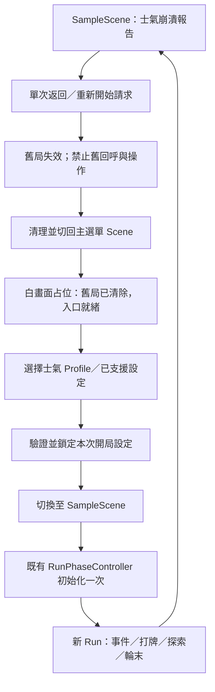

# E3 重開局與主選單場景邊界

更新：2026-11-02，使用者已確認範圍。此文件是待實作規格，不表示 Scene 或接口已建立。

## 場景與畫面名稱

| 名稱 | 職責 | 本階段狀態 |
|---|---|---|
| SampleScene | 遊戲內基地、手牌、事件、探索、輪末與崩潰 | 沿用目前場景，不當主選單 |
| 主選單 Scene | 返回舊局後的入口與新遊戲設定 | E3 先做白背景或其他簡易占位；建議名稱 MainMenu.unity，尚未建立 |
| E3 | 結束舊局、返回、設定驗證、Scene 切換及新局初始化的流程部件 | 待實作，可由未來正式主選單 UI／開局設定畫面接線 |
| PB-P3-005 | 正式主選單布局、方案呈現、美術與 UI 接線 | 新增未排程 Story，依賴 E3，不反向阻擋 E3 |

此處 Stage 指士氣 Profile（金字塔完整方案），不是地圖／劇本，也不是直接選擇 MoraleCollapseStage。新局仍從 Stage 0 開始。其他開局設定只預留擴充邊界，本次不憑空新增選項。

## E3 要通過的路徑

切換與清理可依所有權分段進行；入口顯示不等於清理完成，Ready 必須代表舊局清理已結束。在確認新遊戲前不建立可操作 Run。無效選擇／場景遺漏／載入或初始化失敗時維持安全不可操作狀態，回報原因並允許返回入口重試。

## 職責與接口方向

- 主選單 UI／占位控制只發送返回、選擇、確認開始等請求及顯示流程狀態，不擁有權威遊戲資料。
- E3 控制流程與轉場去重，跨 Scene 只傳本次有效設定、必要快照及識別；不能把舊 Run 放入常駐物件直接帶到新局。
- RunPhaseController 及既有各系統維持初始化／資料所有權；先驗證再修改，處理 startRunOnAwake 避免雙重開局。
- CollapseReportView 保留 RestartRequested 等輸出，交由 E3 接管；不增加另一套重設邏輯到報告元件。
- 正式主選單稍後替換占位 UI 時，沿用相同流程接口；具體類名／API 簽章於實作與 API 文件中確定，本規格不虛構已存在接口。

## 整局清理的範圍

場景卸載不保證清除 static System、事件訂閱或跨場景物件。實作前需盤點：卡組與倉庫實例、牌區／替換 Session、建築施工／製作與資源保留、探索地區／卡包、事件與 RunFlag、資源／人口、士氣與上限／崩潰階段、Profile 階段修正、下輪效果、日期與階段、隨機與本局設定的持有狀態、UI 通知／危險確認／報告／動畫佇列、操作鎖、協程及訂閱。

舊局先以明確的生命週期識別失效，舊回呼不得進事件、解鎖新局或回寫資料。當前有哪些初始化接口能完整清理需由程式盤點確認，不能僅呼叫一個 Reset 就宣稱全部完成。共用 ScriptableObject 定義、場景排版、存檔及歷史紀錄不是要刪除的單局資料。新局初始值只在確認後由初始化流程建立。

## E3 與正式 UI 的驗收界線

E3 用占位 Scene 驗收「崩潰 → 返回主選單 → 舊局清空 → 選設定 → 切 Scene 開新局」與重複操作、錯誤、舊回呼隔離。需要實際跨 Scene Play，不能拿同場景面板切換或舊 E2 單元測試代替。

正式主選單的三階卡片排版、素材、選單動畫及雙解析度／灰階畫面驗收移至 PB-P3-005。E2 原本的 Gameplay／跨階視覺與輸入驗收仍保留在其 Story，不因 E3 拆 UI 而取消或自動通過。存檔、終局、額外設定玩法與 HUD-001 不包含在 E3。
