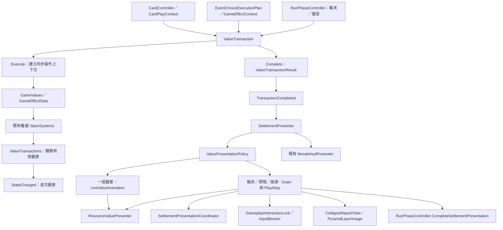

> 2026-10-31 文件遷移：這份 API 保留 2026-10-30 程式快照；後續進度以 ../Story-Sequence.md，技術債以 ../Technical-Debt.md 為準。

# E2 API 與程式碼整理

更新日期：2026-10-30。範圍：E2 交易與演出、Sample E1/E2 整合，以及使用者本次手動調整。這是依目前磁碟程式碼整理的內部 API 文件，不代表全功能已通過驗收。程式路徑均相對 Unity 專案根目錄。

## 1. 完成內容與邊界

- 將一次出牌、事件選項、輪末的變更整合成 ValueTransaction，保存前後快照、逐次有效變更及士氣批次結果。
- 使用既有 FoodSystem／ResourceSystem／EnergySystem／CombatSystem／MoraleSystem 作為唯一權威資料；新增轉接層不另存遊戲數值。
- UI 根據完成結果播放淨變化，普通變更不鎖操作；固定輪末、任何時段的士氣跨階與崩潰走集中演出。
- 輪末數值結算先完成，演出完成後才交接下一流程。失敗守衛不等待動畫。
- 增加集中演出、階段金字塔、崩潰報告與 QA 工具；另存 Sample 測試副本並整合 E1/E2 到主場景，保留真正打牌與事件控制器。
- 不包含完整 E3 重開／離局流程、資源系統全面重寫、交易回滾或完整 HUD 重構。
- 使用者最新手動修改：InTurnfadeDuration 預設 0.75 秒、Update Style 選單、能量主數字在 PresentLive 與 Present 直接顯示最終值。這些不是最初 E2 測試版本。

## 2. 腳本關係



一般路徑：OnCompleted → live.Submit → Update/Tick → RenderLiveFrame → PresentLive。
集中路徑：OnCompleted → 入佇列與取得鎖 → DrainSafely → Drain → PlayStep → Present → Synchronize → 流程交接。

## 3. 資料與交易 API

命名空間：ZombieCardSurvive.Systems.Transactions。
檔案：Assets/Scripts/ValueSystems/Transactions/ValueTransactions.cs。

### ValueId／ValueTransactionKind

ValueId：Food、TemporaryFood、Resource、Combat、Energy、Morale、MaximumMorale、ReservedFood、ReservedResource、FoodCapacity、MaximumEnergy、MaximumCombat、MoraleStage。
目前觀察橋接與動畫陣列依賴列舉從零連續編號；新增種類須同時更新快照、Get、觀察範圍與測試，不能只加列舉。
Kind：Card、Event、RoundEnd、System、Reset。分類不等於演出位置，Card 也可能因跨階而阻塞。

### ValueSnapshot（readonly struct）

| API | 用途 |
|---|---|
| static Capture() | 複製目前所有受支援數值，不是共享可變快照 |
| Get(ValueId id) → int | 讀取該種類；不支援的種類丟出例外 |

### ValueChangeResult（readonly struct）

建構子：(long transactionId, ValueId id, int before, int after, string source)。
唯讀成員：TransactionId、Id、Before、After、Source；Delta 為 long，等於 After - Before。
代表一次觀察到的有效變更；同一筆交易可包含多個同種類變更。

### ValueTransactionResult

| 成員 | 意義 |
|---|---|
| Id／Source／Kind | 交易識別、來源與分類 |
| Before／After | 交易開始與完成快照 |
| Changes | 完成時複製為唯讀集合的逐次變更 |
| Delta(id)／Net(id) | 整筆交易的淨差值／淨變更資料 |
| Morale | 士氣批次，可能為 null；保留來源與跨階紀錄 |
| Profile／StableThreshold／CriticalThreshold | 完成時捕捉的金字塔設定與門檻 |
| IsCollapsed | 是否已崩潰 |
| Interrupted | 有有效變更但未正常 Complete，由 Dispose 收尾 |
| PrimaryMoraleLossSource | 依請求的士氣及上限負向貢獻排序取主要來源，不代表精確實際損失歸因 |

Changes 與淨差值用途不同：扣 2 再加 2 可以保留兩次變更，但 Delta 為零。UI 主要讀淨差值；未來統計可讀逐次紀錄。

### ValueTransaction（IDisposable）

| API | 行為與限制 |
|---|---|
| new ValueTransaction(source, kind) | 配發 ID 並捕捉 Before |
| Execute(Action)／Execute<T>(Func<T>) | 同步執行操作，在操作期間串接既有 System 通知；回傳原操作結果 |
| AttachMorale(MoraleBatchResult) | 附加士氣結果，避免相同 ChangeResult 重複收錄 |
| AttachRound(RoundEndReport) | 保存輪末報告，附加其士氣批次；RoundReport 在交易上，不直接暴露於完成結果 |
| Complete() → ValueTransactionResult | 捕捉 After、發布完成通知；重複呼叫回傳同一 Result，不重複發布 |
| Dispose() | 正常完成後無作用；未完成且有變更時發布 Interrupted 結果；未改動則直接關閉 |

公開屬性：Id、Source、Kind、Before、Changes、Morale、RoundReport、Result。
Execute 可重入同一交易；不允許在另一筆仍執行的交易中自行開啟獨立 Execute。Complete 不可在 Execute 尚未返回時呼叫。此機制是同步上下文，不支援跨 await 的交易流轉，也不提供原子提交或自動回滾。

用法示例：

```csharp
using (var transaction = new ValueTransaction("Example", ValueTransactionKind.System))
{
    bool paid = GameValues.Resource.TrySpend(2, transaction);
    if (paid)
        GameValues.Energy.Change(1, transaction);
    transaction.Complete();
}
```

付款失敗要由呼叫流程決定後續，不能假定 Complete 或 Dispose 會撤回先前操作。

### ValueTransactions（static 事件橋接）

| API／事件 | 用途 |
|---|---|
| EnsureInitialized() | 接上既有 Systems 的通知，重複呼叫不重複註冊 |
| StateChanged(ValueChangeResult) | 每次實際觀察到的數值變更；原 Systems 自己的事件仍保留 |
| TransactionCompleted(ValueTransactionResult) | 一次操作完成；UI 主要入口 |
| ResetRequested() | 呈現重設通知，不是資源重設命令 |
| ResetPresentation() | 更新觀察基準並發送重設；不可在 Execute 中呼叫 |
| IsExecuting／CurrentSequence | 是否有同步交易上下文／目前交易序號 |

未包入明確交易的舊 System 通知會被轉成即時 System 交易，不能自動推知多次呼叫應屬同一張牌。需要淨變化整合時應由外部明確建立交易。StateChanged／TransactionCompleted 逐訂閱者隔離例外；ResetRequested 不採相同安全派送，後續可評估一致性。

## 4. 通用數值操作 API

檔案：Assets/Scripts/ValueSystems/Transactions/GameValues.cs。

```csharp
public interface IGameValue
{
    ValueId Id { get; }
    int Current { get; }
    bool Set(int value, ValueTransaction transaction);
    bool Change(int delta, ValueTransaction transaction);
    event Action<ValueChangeResult> StateChanged;
    event Action<ValueTransactionResult> TransactionCompleted;
}
public interface ISpendableValue : IGameValue
{
    bool CanSpend(int amount);
    bool TrySpend(int amount, ValueTransaction transaction);
}
```

GameValues.Food／Resource／Combat／Energy 為 stateless 轉接物件；All 為四者的唯讀清單。士氣等特殊系統仍使用專屬批次 API，不強迫所有系統套用 Change。

- Change 正數呼叫既有增加接口；負數檢查可用量後付款；int.MinValue 回傳 false。
- Set 透過與 Current 的差額呼叫 Change，不是強制覆蓋內部值；受保留、上限與既有系統規則約束。
- TrySpend 不自動 Complete；外部控制流程負責交易生命週期。
- bool 代表操作是否被接受，不保證正向請求量完整入帳；實際結果請讀完成快照與 Delta。
- Current 讀取原 System 對應值，不一律等於可用量；CanSpend 使用各自可用量規則。
- 轉接物件完成事件僅在 Changes 包含其 Id 時轉送；即使淨差為零，只要有該種類逐次變更仍可能通知。

## 5. 演出 API

命名空間：ZombieCardSurvive.UI.Settlement。

### ValuePresentationPolicy（普通 C# static）

RequiresBlocking(ValueTransactionResult result) → bool：固定輪末、士氣 StageChanged 或 IsCollapsed 為 true；null 與 Reset 為 false。
不是局內／局外判定。

### LiveValueAnimation（普通 C# 物件，不掛 GameObject）

| API | 用途 |
|---|---|
| Submit(result, float seconds) | 設定所有種類的起點、終點、累計淨變化及共用時間 |
| Tick(float seconds) | 推進時間，負值按零處理；由 Presenter.Update 呼叫 |
| Displayed(ValueId) → int | 線性插值後四捨五入的顯示值 |
| Delta(ValueId) → long | 浮動文字使用的累積淨差值 |
| Target | 最新目標快照 |
| IsActive／Progress | 動畫是否進行／0 到 1 進度 |
| Clear() | 停止並清空動畫陣列，不修改遊戲資源；Target 並未在此重設 |

新交易在舊動畫中途到達時，從目前可見位置接續到最新目標，重新計時並合併浮動變化量。duration 最低 0.001 秒；傳零並非獨立關閉主數字漸變，會同時讓浮動提示很快結束。所有數值目前共用時間，沒有每種類別獨立速度。

### IValuePresentation／ResourceValuePresenter（掛在數值 UI 上）

| API | 用途 |
|---|---|
| Id | 由序列化 valueId 決定負責哪一種數值 |
| Configure(ValueId id, TMP_Text text, TMP_Text delta) | 設定文字引用，重新擷取原色並套用樣式；不是 Unity 自動回呼 |
| Present(ValueTransactionResult transaction, float progress) | 集中演出入口，讀淨變化，包含食物特殊合併 |
| Present(ValueChangeResult result, float progress, ValueSnapshot context) | 依進度插值主數字並顯示增減量；能量直接取 After |
| PresentLive(int displayedValue, int displayedTemporaryFood, ValueSnapshot target, long delta, float progress) | 一般動畫入口；主數字通常使用外部算好的值，能量取 target；浮動文字 alpha = 1 - progress |
| Synchronize(ValueSnapshot snapshot) | 立即顯示快照並清空浮動文字 |

IValuePresentation 目前包含 Id、兩種 Present 與 Synchronize；不包含 PresentLive。SettlementPresenter 的陣列也仍使用具體 ResourceValuePresenter，尚未完全依賴介面。

Configure 的直接呼叫目前在 SettlementE2Setup.Install 和 ValuePresentationRoutingTests 的 fixture；Sample 整合工具間接呼叫安裝。正常打牌／輪末不會呼叫 Configure。

樣式設定：deltaFontSize 預設 34、deltaSize 預設 180×54、deltaOffset 預設 (0,4)，紅負綠正、加粗描邊。Awake 首次套用，deltaStyleApplied 避免重複設定。Inspector 修改不會自動清除此旗標；使用者新增的元件選單 Update Style 可手動清除旗標並重新套用。

目前差異須注意：PresentLive 的浮動文字隨進度淡出；Present 的浮動文字維持不透明，再由同步清除，不能宣稱兩條路徑的漸出完全相同。

目前食物主字為永久食物／容量，附加臨時食物與「鎖」文字；資源主字扣除 ReservedResource。食物尚未統一為扣保留的可用量。可用量及黃色獨立臨時食物是討論方向，尚未實作。不要覆蓋使用者新增的黃色文字物件。

### SettlementPresenter（MonoBehaviour，集中演出物件）

| 公開 API | 用途 |
|---|---|
| Configure(owner, baseHud, morale, resources, blocker, stage, stageBody, summary, layers, collapse) | 設定 Run、HUD、數值元件、遮罩、階段面板及報告引用 |
| IsBlockingPresentation | 有 active 或 queue；是否正由集中演出處理 |
| IsLiveAnimating | 一般動畫是否仍在進行 |
| IsPresenting | 上述任一成立；不能用它直接判斷是否禁止操作 |
| SetReducedMotion(bool) | 改用縮短動畫並同步士氣 HUD 設定 |
| SkipCurrentStep() | 集中演出時標記略過目前步驟 |

主要內部流程：
- OnEnable 訂閱完成／重設、接管既有 HUD 刷新、註冊 Run、同步現況。
- OnCompleted 去重、排除舊局結果、依政策分流。一般動畫不取得新鎖；集中路徑清除 live、入列並取得鎖。
- Update 在無集中演出時 Tick／RenderLiveFrame；左鍵／Space 可略過目前集中步驟。
- DrainSafely 展開巢狀 IEnumerator，例外時停止演出、對齊真值並釋放自身鎖。
- Drain 順序播放資源、士氣、必要階段面板；完成後以交易 ID 通知 Run。
- PlayStep 計算集中演出的進度；ReleaseInput 等待放開按鍵，避免略過動作穿透至下一流程。
- OnReset／OnDisable 停止協程、清理佇列與 live，避免舊動畫覆寫新局；停用交還 HUD 控制權。

Inspector 一般動畫時間：InTurnfadeDuration 預設 0.75 秒，實際以場景 Inspector 儲存值為準；reducedMotion 為 0.08 秒。Drain 目前硬編碼：資源 0.35、跨階士氣每段 0.35、邊界等待 0.15、最終士氣 0.45、中央階段 2.2 秒；減少動態 PlayStep 0.08、WaitStep 0.01 秒。

### SettlementPresentationCoordinator／SettlementResultFormatter

檔案：Assets/Scripts/Run/SettlementPresentationCoordinator.cs；命名空間 ZombieCardSurvive.Run。
- Current／Generation：目前步驟及世代識別。
- Begin(result, Action onFinished)：建立 Resources → Morale → 可選 Stage 的順序。
- Advance(expectedGeneration) → bool：只接受正確世代，完成回呼只觸發一次。
- Cancel()：取消並遞增世代，使舊呼叫失效。
- Formatter.StageSummary(result)／CollapseSummary(result)：產生階段與失敗說明文字，不改變數值。

### CollapseReportView／PyramidLayerImage

- CollapseReportView.Configure(root, text, restart, leave)：接線與初始隱藏。
- Show(result)／Hide()／IsVisible：顯示報告與查詢狀態。
- RestartRequested／LeaveRequested：外部流程訂閱的要求事件；RequestRestart()／RequestLeave() 具有單次送出守衛。
- 未訂閱對應處理時，按鈕不顯示；報告本身不實作完整重新開局或離局。
- PyramidLayerImage 繼承 Image：Configure(int index)、SetDamaged(bool) 更新自繪層形狀與損毀標記。

## 6. 既有腳本接入點

| 路徑（Assets/Scripts/ 下） | E2 相關調整 |
|---|---|
| Cards/Runtime/CardController.cs | TryPlayCard 包裝 Card 交易，既有交易則加入；付款／效果仍呼叫原邏輯 |
| Cards/Runtime/CardPlayContext.cs | 增加 Transaction，往效果傳遞 |
| Effects/Data/GameEffectContext.cs | Transaction、WithTransaction(...)、事件建構入口帶入交易 |
| Effects/Data/GameEffectData.cs | 通用簡單數值效果透過 GameValues；特殊效果維持原接口 |
| Events/Runtime/EventChoiceExecutionPlan.cs | 一個事件選項以一筆 Event 交易串起付款、效果及後果 |
| ValueSystems/MoraleSystem.cs | 批次／獨立士氣變更加入交易並保留正式跨階結果 |
| Run/RunPhaseController.cs | 輪末建立交易與 pending ID，等待演出後交接；StartRun 重設演出 |
| UI/World/GameplayHudRuntimePresenter.cs | 完成結果刷新及 ValuesPresentationOwnedExternally 接管旗標、資源文字存取 |
| UI/Morale/MoraleHudPresenter.cs | SetSettlementPresentationOwned、ShowPresentedMorale、CloseDetail、SetReducedMotion |
| Cards/UI/ResourceDebugView.cs | primaryValuesOwnedExternally 避免每幀覆寫主要數值 |
| UI/World/P0GameplayHudSliceController.cs | P0 初始化重設演出；不是 Sample 真實打牌控制器 |

RunPhaseController 新接點：RegisterSettlementPresenter(SettlementPresenter)、IsSettlementPending、CompleteSettlementPresentation(long transactionId)。只接受相符 pending ID；無 Presenter 有立即交接後備；失敗不繼續事件階段。

## 7. 場景與編輯器工具

- Assets/Scenes/Sample_E1E2_IntegrationTest.unity：由原 Sample 另存的整合測試場景。
- Assets/Scenes/SampleScene.unity：已整合 E1/E2，保留原場景 GUID。沒有用 P0 假手牌取代真手牌。
- UI/Settlement/Editor/SettlementE2Setup.cs：Install() 僅供 Edit mode 安裝，已有 Presenter 則返回；另有 Play QA TwoStages／Collapse／ReducedMotion。
- UI/Settlement/Editor/SampleE1E2IntegrationSetupUtility.cs：CreateTestScene、ApplyToCurrentScene、ValidateScene／ThrowIfInvalid、PromoteVerifiedTestScene；提升需對應通過的場景雜湊與未改動原場景。
- UI/Settlement/Editor/SampleE1E2PlayProbe.cs：StartChecks／ReadReport；會改動執行中 QA 資料並測至 Failed，不是玩家流程 API，不應將 Play fixture 保存回場景。
- Configure 是接線工具，不是每次動畫重新讀取的入口。刪除 Resource Views 的元件引用不會自動恢復舊 HUD 的立即刷新。

## 8. 已遇問題、處理與目前限制

| 問題 | 處理／現況 |
|---|---|
| 普通打牌也被演出鎖住，操作停頓 | 已分流一般與集中演出；跨階／固定輪末仍保留鎖 |
| 舊 HUD／Debug 每幀蓋過動畫 | 以更新權旗標暫時整合，列入 HUD-001 重構 |
| 元件生命週期順序造成主文字透明 | 擷取正常顏色改為可延後初始化 |
| Sample 固定像素在小畫面裁切控制區 | 整合時改為 ScaleWithScreenSize；所有解析度仍未全面人工驗收 |
| 浮動提示太小 | 放大至預設 34、加粗描邊；樣式實際觀感依人工調整 |
| Inspector 改 offset 看不到變化 | deltaStyleApplied 快取；現有 Update Style 手動刷新，不自動即時更新 |
| 能量隨共享動畫慢慢變動 | 使用者改成主數字直接取最終值；PresentLive 已人工確認，Present 未觀察到對應能量情境 |
| 永久／臨時食物共用文字與浮動淨差 | 尚未拆分；互相抵消可能不顯示浮動數字 |
| Unity 曾崩潰、中斷主場景 Play | 重開後做過磁碟／引用檢查；依使用者要求停止追查，不宣稱該次主場景 Play 通過 |

## 9. 技術債與後續工作（均非本文件已實作）

### HUD-001：使用者確認要保留的技術債

1. 每個數值 UI 只有一個固定寫入者；移除原 HUD／Debug 重複刷新與不必要接管旗標，不再疊加新的 HUD。
2. SettlementPresenter 聚焦集中演出排程與操作鎖；通用數值元件負責主數字、浮動文字及設定。
3. Present 與 PresentLive 統一呈現策略，避免能量立即更新等需求在兩處重複特判；考慮元件設定取代 Energy 硬編碼。
4. 拆開主數字插值與浮動文字漸出時間；評估每種數值獨立速度與是否啟用的設定。
5. PresentLive 的 displayedTemporaryFood 是食物專屬參數，其他元件收到卻不用；整理接口及兩處 Food／TemporaryFood 合併邏輯。
6. IValuePresentation 尚不涵蓋 PresentLive 且 Presenter 依賴具體類別，重構時一併決定抽象邊界，避免只增加空接口。

### 其他待辦與驗證

- 食物／資源以可用量為主、臨時食物下方黃色顯示、保留細節不常駐：UI 方向已討論，但使用者目前暫緩；需先確認臨時食物與保留的精確分配規則。
- 完整重開／離局控制器接上 RestartRequested／LeaveRequested，驗證失敗後清理與新局重設（E3 邊界）。
- 視需求增加動畫開始／完成／被新交易取代的通知，供音效、教學或 UI 串接；目前只是候選，不應讓邏輯結算依賴通知，也不將現有 TransactionCompleted 當成動畫完成。
- 成就／統計可訂閱 StateChanged 並以交易 ID 彙整；永久儲存、歸因規則與去重機制尚未建立。
- 評估靜態訂閱在關閉 Domain Reload、重複 Play 與場景重載時的生命週期；不是本輪已驗證結論。
- 長局 seenResults 集合成長、阻塞期間連續外部交易的快照交接與視覺連續性，可列後續壓力與邊界檢查。
- 目前集中演出的步驟同時寫在 Coordinator 與 Drain，後續避免新增步驟時兩邊不一致。

## 10. 驗證紀錄與不能宣稱的部分

- 初期 E2 曾有 55 項 EditMode 通過；Sample 接線階段 30 項通過，副本七組 Play 檢查通過。這些是不同時間的測試組合，不能加總成目前版本總數。
- 一般動畫分流版本：49 項定向 EditMode 通過（分流 23、交易 17、輪末預警 9）；原始結果在 Assets/GameDevelopmentProcess/Abandoned-plan/production/qa/evidence/pb-p0-014e-responsive-values-tests.json。
- 主場景最後一次 Play 復測被 Unity 崩潰中斷；不宣稱該次通過。
- 使用者本次人工確認：能量 PresentLive 正常。Present 能量路徑尚未因實際輪末能量變動觀察，不為測試而新增輪末扣能量玩法。
- 本次僅讀碼與製作文件，未重新編譯、執行測試、修改場景或程式；既有測試結果不等於涵蓋使用者最新手改。

## 11. 相關文件與後續 API 文件慣例

- Assets/GameDevelopmentProcess/Abandoned-plan/Docs/Architecture/e2-value-transactions.md：原交易架構。
- Assets/GameDevelopmentProcess/Abandoned-plan/Docs/Architecture/e2-responsive-value-presentation.md：一般／集中演出分流歷史；當中 0.32 秒為當時版本，目前預設已改為 0.75 秒。
- Assets/GameDevelopmentProcess/Abandoned-plan/Docs/Architecture/sample-e1-e2-integration.md：Sample 接線與整合。
- Assets/GameDevelopmentProcess/Abandoned-plan/Docs/CodexHandoff/current-context.md、Assets/GameDevelopmentProcess/Abandoned-plan/production/session-state/active.md：HUD-001 交接紀錄。

使用者要求：往後每個大進度完成時製作／更新 API 文件，統一放在 Assets/GameDevelopmentProcess/ScriptCodeReview。文件至少包含目前版本與範圍、公開 API／事件、腳本關係圖、既有接點與 Inspector 設定、呼叫範例、已遇問題、驗證邊界、技術債及後續擴充。依實際程式更新，將已實作、已驗證與提案分開記錄；保留歷史版本可追溯性。
